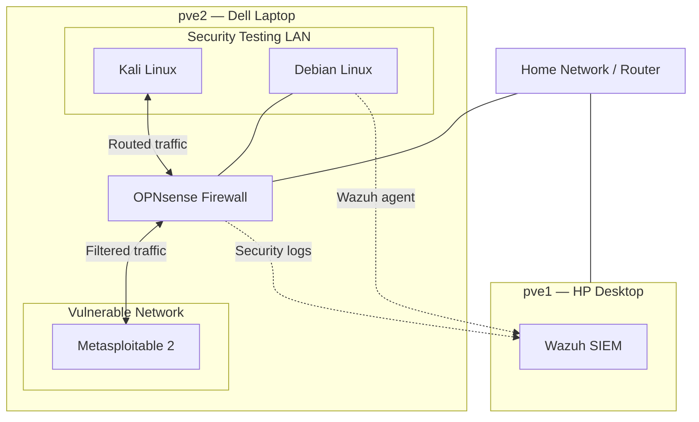

# Cybersecurity Homelab — Network Topology

**Project:** PRJ-001  
**Diagram Type:** Logical network architecture  
**Status:** Documented and maintained

## Network Diagram

## Network Zones

### Primary Network

Provides connectivity to the Proxmox infrastructure
and selected management services.

### Security Testing LAN

Hosts security testing and monitored Linux systems,
including Kali Linux and Debian.

### Vulnerable Network

Contains Metasploitable 2, an intentionally vulnerable
system used for authorized security testing.

OPNsense controls routed communication between the
security testing and vulnerable networks.

## Verified Traffic Flow

Previous testing confirmed communication from Kali Linux
to Metasploitable through OPNsense.

OPNsense firewall logs provided visibility into the
associated traffic.

## Security Monitoring

Wazuh provides centralized security monitoring.

OPNsense and Debian have been integrated with Wazuh
for security event collection and investigation.

## Diagram Notes

- This is a logical architecture diagram.
- Physical wiring and bridge uplinks are not depicted.
- Live IP addresses and management endpoints are excluded.
- Monitoring relationships are distinct from traffic paths.
- The diagram is maintained as the environment changes.
